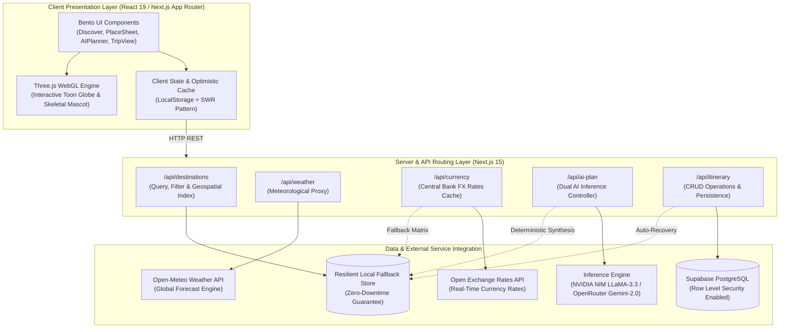
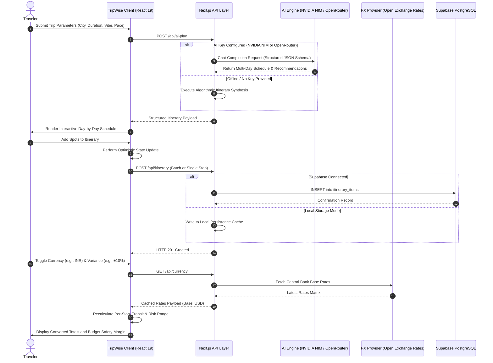
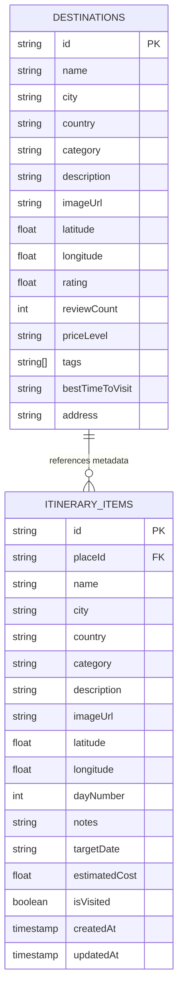

# TripWise - Smart Travel Planner

[](https://github.com)
[](https://nextjs.org)
[](https://react.dev)
[](https://www.typescriptlang.org)
[](https://threejs.org)
[](https://supabase.com)
[](https://open-meteo.com)
[](https://open.er-api.com)
[](https://build.nvidia.com)

> **AWS Student Builder Group, VIT Chennai - Web Development Recruitment Task**  
> **Track:** Track 3: Full-Stack Development

---

## Executive Summary

TripWise is an enterprise-grade, full-stack travel intelligence and itinerary management platform engineered with Next.js 15 (App Router), React 19, and Three.js. The application integrates real-time meteorological forecasts, geospatial 3D globe visualization with spherical coordinate raycasting, algorithmic multi-modal transit estimations, dual-engine generative AI itinerary synthesis (supporting NVIDIA NIM and OpenRouter), live central bank foreign exchange conversions with risk-variance buffering, and resilient database persistence with Supabase PostgreSQL and automated offline fallbacks.

The user interface adheres to a Neo-Brutalist Bento design system engineered using native CSS custom properties and atomic tokens, ensuring zero external component library overhead, rigorous WCAG accessibility compliance, and optimized performance.

---

## System Architecture

TripWise follows a modular full-stack architecture separating presentation, 3D WebGL rendering, edge routing, inference processing, and data persistence.



---

## Data Flow & Lifecycle Sequence

The following sequence details an end-to-end trip creation lifecycle, encompassing generative itinerary synthesis, database persistence, and live multi-currency recalculation.



---

## Database Entity-Relationship Model



---

## Core Capabilities

### 1. Geospatial Discovery & Hierarchical Exploration
- **3D Toon Globe Engine:** Built with Three.js, featuring an equirectangular land-water projection shader, procedural atmospheric cloud clusters, an orbiting animated Flamingo GLTF entity, raycasting for interactive coordinate pins, and smooth spherical flight camera arcs.
- **Hierarchical Drilldown:** Two-stage cascading filter system (Country -> City -> Category) covering 68 world-class destinations across 11 nations (India, Japan, France, United States, Italy, Indonesia, United Kingdom, United Arab Emirates, Singapore, Thailand, Spain).
- **Debounced Instant Search:** 350ms input debounce mechanism filtering across destination titles, cities, countries, and descriptive metadata tags.
- **Dynamic City Marquee:** Smooth continuous ticker with pause-on-hover interaction.

### 2. Slide-In Place Detail Sheet
- **Accessible Modal Drawer:** Keyboard `Escape` dismiss, focus trap, and backdrop dismissal.
- **Real-Time Meteorological Tile:** Live integration with Open-Meteo API displaying current ambient temperature, humidity, wind velocity, and a 5-day daily forecast with high/low margins.
- **Bento Fact Matrix:** Highlights optimal seasonal visiting windows, pricing tiers (`$15`, `$$40`, `$$$90`, `$$$$180`), user ratings with sample review volumes, formatted physical addresses, and direct OpenStreetMap geographic links.
- **Itinerary Assignment Form:** Allows custom day allocation (Days 1 to 10), prefilled per-person ticket estimates, personal visit notes, and removal controls.

### 3. Dual-Provider AI Itinerary Generator
- **Universal Provider Architecture:** Native plug-and-play compatibility with either **NVIDIA NIM** (`meta/llama-3.3-70b-instruct`) or **OpenRouter** (`google/gemini-2.0-flash`).
- **Resilient Fallback Mode:** In environments where external API keys are omitted or rate-limited, the system seamlessly transitions to an internal deterministic travel synthesis algorithm, guaranteeing 100% service uptime.
- **Structured Schedule Output:** Outputs day-by-day itineraries with morning, afternoon, and evening timelines, local cultural tips, packing checklists, and local cuisine suggestions.
- **One-Click Itinerary Import:** Allows travelers to add individual stops or entire day itineraries directly into their itinerary with automatic tag and coordinate normalization.

### 4. Itinerary Management, Currency Converter & Route Engine
- **Day-by-Day Timeline Management:** Groups stops by assigned itinerary days with calendar dates computed from the user's defined start date.
- **Inline Item Manipulation:** Real-time editing of travel notes (auto-PATCH on blur), day reassignment, ticket cost modification, and animated visit status toggles.
- **Live Currency Converter:** Converts all activity, transit, and overall trip totals into 12 major international currencies (USD, INR, EUR, GBP, JPY, AED, SGD, THB, IDR, AUD, CAD, CHF) using fresh central bank FX data fetched via `/api/currency`.
- **Foreign Trip Risk-Variance Buffer:** Provides selectable tolerance toggles (`±0%`, `±5%`, `±10%`, `±15%`) to calculate realistic minimum and maximum foreign expenditure boundaries, accounting for credit card foreign transaction fees (2% to 3%), local tips, and exchange rate volatility.
- **Algorithmic Multi-Modal Route Estimator:** Computes pairwise Haversine Great-Circle transit legs between consecutive stops, comparing five distinct transport modes:
  - **Walking:** Free of charge, evaluated for distances $d \le 5$ km.
  - **Cab / Taxi:** Vehicle-scaled rates based on group passenger count.
  - **Bus Transit:** Cost-effective regional travel for intermediate distances.
  - **Intercity Train:** Rail option for medium-to-long continental distances within identical national boundaries.
  - **Commercial Flight:** High-speed transit evaluated for intercity legs $d \ge 250$ km.
- **Optimization Strategy Toggle:** Allows switching route recommendations between *Cheapest*, *Balanced*, and *Fastest* scoring profiles.
- **Empty State Mascot:** Three.js skeletal animated walking Fox canvas displayed when the itinerary is unpopulated.
- **Plan Export:** Plain-text formatted export (`.txt`) containing the schedule, notes, currency breakdown, and estimated risk boundaries.

---

## Technical Specifications

| Component | Technology | Rationale & Implementation Details |
| :--- | :--- | :--- |
| **Frontend Framework** | Next.js 15.4+ (App Router) | Server Components where applicable; selective Client Components (`'use client'`) for interactive panels. |
| **UI Library** | React 19 | Concurrent rendering, modern hooks, and transition primitives. |
| **Language** | TypeScript 5 (Strict Mode) | Full type-safety across API contracts, UI props, and external integration payloads. |
| **Styling Architecture** | Pure CSS Variables & Bento Tokens | Zero CSS-in-JS runtime overhead; custom design tokens (`--cv`, `--pp`, `--ink`, `--tom`, `--sun`, `--mint`, `--sky`, `--pink`, `--lil`). |
| **Typography** | `next/font/google` | Self-hosted Google Fonts: Bricolage Grotesque (Headings), Instrument Sans (Body), Caveat (Handwritten Accents). |
| **3D Rendering** | Three.js (`three` + `GLTFLoader`) | Dynamic WebGL canvas components with client-side dynamic loading (`ssr: false`). |
| **Database** | Supabase (PostgreSQL) | Managed relational storage with Row Level Security (RLS) policies and automatic local storage fallback. |
| **Meteorological Data** | Open-Meteo API | Free, unauthenticated global weather API with 1-hour response caching. |
| **Currency Data** | Open Exchange Rates API | Free public central bank FX rates cached at `/api/currency` with comprehensive offline fallback matrix. |
| **AI Inference** | NVIDIA NIM / OpenRouter | Dual-adapter pattern supporting high-performance LLaMA 3.3 and Gemini 2.0 Flash models. |
| **Visual Verification** | Playwright Test Suite | Automated headless script (`scripts/screenshots.ts`) capturing high-resolution desktop and mobile viewports. |

---

## Backend REST API Reference

All endpoints return a uniform JSON envelope:

```json
{
  "success": true,
  "data": {},
  "message": "Operation completed successfully"
}
```

### Endpoints Specification

| Method | Endpoint | Query / Body Parameters | Description |
| :--- | :--- | :--- | :--- |
| `GET` | `/api/destinations` | `country`, `city`, `category`, `search`, `sortBy` | Retrieves filtered catalog of destinations with computed metadata. |
| `GET` | `/api/destinations/[id]` | Route parameter: `id` | Retrieves detailed destination metadata bundled with real-time weather. |
| `GET` | `/api/weather` | `lat`, `lon`, `city` | Returns current weather metrics and 5-day meteorological forecast. |
| `GET` | `/api/currency` | None | Returns latest exchange rate matrix and live connectivity status. |
| `GET` | `/api/itinerary` | None | Fetches all persisted user itinerary items. |
| `POST` | `/api/itinerary` | `placeId`, `dayNumber`, `notes`, `estimatedCost` | Persists a new destination stop to the user's travel itinerary. |
| `PATCH` | `/api/itinerary/[id]` | `isVisited`, `dayNumber`, `notes`, `estimatedCost` | Updates an existing itinerary record. |
| `DELETE` | `/api/itinerary/[id]` | Route parameter: `id` | Removes an individual stop from the itinerary. |
| `DELETE` | `/api/itinerary` | None | Clears all stops from the active itinerary. |
| `POST` | `/api/ai-plan` | `{ city, days, theme, pace }` | Invokes the AI inference engine to synthesize a multi-day itinerary. |

---

## Database Configuration (Supabase)

To link an external Supabase PostgreSQL instance:

1. Create a project at [supabase.com](https://supabase.com).
2. Execute the following schema in the Supabase **SQL Editor**:

```sql
CREATE TABLE IF NOT EXISTS public.itinerary_items (
    id TEXT PRIMARY KEY,
    "placeId" TEXT NOT NULL,
    name TEXT NOT NULL,
    city TEXT NOT NULL,
    country TEXT NOT NULL,
    category TEXT NOT NULL,
    description TEXT,
    "imageUrl" TEXT,
    latitude DOUBLE PRECISION,
    longitude DOUBLE PRECISION,
    "dayNumber" INTEGER DEFAULT 1,
    notes TEXT,
    "targetDate" TEXT,
    "estimatedCost" DOUBLE PRECISION DEFAULT 0,
    "isVisited" BOOLEAN DEFAULT false,
    "createdAt" TIMESTAMP WITH TIME ZONE DEFAULT timezone('utc'::text, now()) NOT NULL,
    "updatedAt" TIMESTAMP WITH TIME ZONE DEFAULT timezone('utc'::text, now())
);

ALTER TABLE public.itinerary_items ENABLE ROW LEVEL SECURITY;
CREATE POLICY "Public Access" ON public.itinerary_items FOR ALL USING (true);
```

3. Populate `.env.local` with the target credentials:

```env
NEXT_PUBLIC_SUPABASE_URL=https://your-project.supabase.co
NEXT_PUBLIC_SUPABASE_ANON_KEY=your-anon-key-here
```

*Note: If database credentials are not configured, TripWise automatically operates in resilient local storage mode, ensuring full offline functionality.*

---

## Environment Configuration

Configure the application by creating a `.env.local` file in the root directory based on `.env.example`:

| Variable | Requirement | Description |
| :--- | :--- | :--- |
| `NEXT_PUBLIC_SUPABASE_URL` | Optional | Supabase Project URL for relational itinerary persistence. |
| `NEXT_PUBLIC_SUPABASE_ANON_KEY` | Optional | Supabase anonymous public API key. |
| `OPENROUTER_API_KEY` | Optional | OpenRouter API Key (Alternative 1 for AI planner). |
| `NVIDIA_API_KEY` | Optional | NVIDIA NIM API Key (Alternative 2 for AI planner). |
| `GEOAPIFY_API_KEY` | Optional | Places API key for supplementary geographic lookups. |

---

## Local Development & Build Verification

### 1. Prerequisites
- Node.js version 18.18+ or 20+
- npm version 9+

### 2. Installation
```bash
git clone <repository-url>
cd tripwise
npm install
```

### 3. Development Server
```bash
npm run dev
```
Navigate to [http://localhost:3000](http://localhost:3000) to view the application.

### 4. Code Quality & Build Verification
```bash
# Verify TypeScript strict type-checking
npx tsc --noEmit

# Execute ESLint verification
npm run lint

# Compile production build
npm run build
```

---

## Automated Verification & Artifacts

TripWise includes an automated Playwright visual testing script (`scripts/screenshots.ts`) that launches the production build and captures comprehensive desktop (1360x900) and mobile (390x844) viewport screenshots into `/screenshots`:

```bash
# Start production server
npm run build
npm run start -- -p 3000

# Run automated screenshot capture
npx tsx scripts/screenshots.ts
```

### Generated Visual Artifacts

| Filename | Viewport | Scope & Features Captured |
| :--- | :--- | :--- |
| `discover.png` | Desktop | Hero bento, self-drawing SVG squiggles, 3D interactive toon globe, live stats count-up. |
| `search-results.png` | Desktop | Debounced search query results across destinations catalog. |
| `filtered-by-category.png` | Desktop | Hierarchical country and category chip active states. |
| `empty-results.png` | Desktop | Empty state UI with graceful fallback and search reset trigger. |
| `place-sheet.png` | Desktop | Slide-in drawer with Open-Meteo live weather forecast and bento facts. |
| `ai-planner-result.png` | Desktop | AI-generated multi-day itinerary with timeline spots and packing recommendations. |
| `trip-populated.png` | Desktop | Itinerary timeline, live currency conversion, foreign trip buffer, and transit routes. |
| `trip-empty.png` | Desktop | Interactive Three.js skeletal walking Fox canvas mascot. |
| `dark-mode.png` | Desktop | High-contrast Neo-Brutalist dark color palette. |
| `discover-mobile.png` | Mobile (390px) | Single-column responsive layout with fixed bottom navigation bar. |
| `place-sheet-mobile.png` | Mobile (390px) | Full-width mobile place sheet with meteorological forecast tile. |
| `trip-mobile.png` | Mobile (390px) | Mobile itinerary view with budget tracking and currency conversion. |

---

## Third-Party Attributions & Licensing

- **Meteorological Data:** Provided by [Open-Meteo](https://open-meteo.com/), licensed under [Creative Commons Attribution 4.0 International (CC BY 4.0)](https://creativecommons.org/licenses/by/4.0/).
- **Foreign Exchange Rates:** Provided by [Open Exchange Rates](https://open.er-api.com/).
- **Geographic Data:** Map references courtesy of [OpenStreetMap](https://www.openstreetmap.org/) contributors (ODbL).
- **Flamingo 3D Model:** Distributed by [three.js](https://github.com/mrdoob/three.js) (mrdoob).
- **Fox 3D Model:** Low-poly character model by PixelMannen (CC0), rigging and animation by @tomkranis ([CC BY 4.0](https://creativecommons.org/licenses/by/4.0/)), sourced from the [Khronos glTF Sample Models](https://github.com/KhronosGroup/glTF-Sample-Models).
